# knowledge-graph

Playground สำหรับลองทำ Knowledge Graph + GraphRAG ด้วย Ollama + NetworkX ไม่ต้องใช้ Docker

> model เริ่มต้น `gemma4:31b-cloud` **รันบน cloud** (ข้อความที่ ingest/ask จะถูกส่งออกจากเครื่อง) ถ้าเป็นข้อมูลภายใน ให้ใช้ model ในเครื่อง เช่น `KG_MODEL=qwen3:8b`

เริ่มจากศูนย์? อ่าน [docs/ — KG 101](docs/README.md)

## โครงสร้าง

```
kg/, main.py              engine ใช้ร่วมกันทุกโดเมน
examples/
  thai-tourism/           ตัวอย่างสำหรับเรียน: เอกสารข้อความ → LLM → กราฟ (docs บทที่ 1–4)
  retail-demo/            ตัวอย่างระบบค้าปลีก (ข้อมูลสมมติ): ontology + CSV + เอกสาร (docs บทที่ 5–6)
domains/                  โดเมนของคุณเองตอนลองในเครื่อง (gitignore ไว้ ไม่ขึ้น GitHub)
docs/                     KG 101 ภาษาไทย
```

ทุกคำสั่งรับ `--domain <โฟลเดอร์>` (ค่าเริ่มต้นคือ `examples/thai-tourism`) กราฟของแต่ละโดเมนจะเก็บไว้ที่ `<โฟลเดอร์>/graph.json`

## RAG vs GraphRAG

|                        | Vector RAG                           | GraphRAG (โปรเจกต์นี้)                                |
| ---------------------- | ------------------------------------ | ---------------------------------------------------------------- |
| Ingest                 | chunk → embed → vector DB          | chunk →**LLM extract triples** → graph                   |
| หน่วยข้อมูล | chunk ของข้อความ           | `(subject) -[RELATION]-> (object)`                             |
| Retrieve               | top-k similarity                     | หา seed entity → เดิน k-hop รอบๆ                      |
| เก่งเรื่อง   | "ข้อความไหนพูดถึง X" | คำถาม multi-hop, ความสัมพันธ์, การ aggregate |

## Architecture

[](docs/diagrams/architecture.svg)

> 🔍 **เวอร์ชัน interactive** (ซูม · คลิกดูเส้นทาง · สลับธีม): clone repo แล้วเปิดไฟล์ `docs/diagrams/architecture.html` ในเบราว์เซอร์ (GitHub แสดงไฟล์ HTML เป็นโค้ด)

- **ข้อมูลเข้าได้ 2 ทาง:** ตาราง (`ingest-csv`) เข้ากราฟตรงๆ แม่นยำและไม่ใช้ LLM ส่วนเอกสาร (`ingest`) ต้องให้ LLM ดึง triples ออกมาก่อน
- **ทั้งสองทางผ่าน `domain.py`** ซึ่งตรวจกับ ontology และ entities ทำให้กราฟสะอาด ชื่อไม่ซ้ำ และทิศทางถูกต้อง (ถ้าโดเมนไม่มี ontology เช่น `thai-tourism` ข้อมูลจะเข้ากราฟโดยไม่ผ่านการตรวจ) ตอนถามคำถาม `domain.py` ยังส่ง aliases และความหมายของ relation ให้ `query.py` ด้วย
- **ข้อมูลออกได้ 3 ทาง:** `impact` เดินกราฟล้วนๆ, `ask`/`eval` ใช้ GraphRAG (LLM ตอบจาก facts ในกราฟเท่านั้น), `viz` ใช้ดูภาพกราฟ
- **คนอยู่ในวงเสมอ:** `ingest` รายงาน entity ใหม่ให้คนตัดสินว่าจะเพิ่มใน entities.csv ไหม และเมื่อ `eval` ไม่ผ่าน คนแก้ไฟล์ข้อมูลแล้วรันใหม่ งานหลักของ KG จึงอยู่ที่การดูแลข้อมูล ไม่ใช่โค้ด
- แผนภาพนี้แสดงเฉพาะสิ่งที่ repo มีจริง ส่วน service ที่ระบบ production มักเพิ่ม (embedding + vector index, reranker, graph DB, community summarizer) ดูได้ใน [docs/03 → Service / component](docs/03-graphrag-vs-rag.md#service--component-ของแต่ละแบบ)

### กระบวนการทำงาน

รหัส A1, B2, … ตรงกับป้ายบนเส้นในแผนภาพด้านบน

**A. สร้างกราฟ** — `ingest-csv` / `ingest`

| ขั้น | เกิดอะไรขึ้น | ที่ไหน | LLM? |
|---|---|---|---|
| A1 | ข้อมูลเข้ามา 2 ทาง: ตาราง `triples.csv` หรือเอกสารข้อความ (ตัดเป็น chunk ตามย่อหน้า) | `main.py`, `extract.chunk()` | ❌ |
| A2 | ส่งแต่ละ chunk ให้ LLM ดึง triples `(subject, relation, object)` โดยแนบ ontology และรายชื่อ entity ที่รู้จักไปใน prompt (เฉพาะทางเอกสาร) | `extract.py` | ✅ |
| A3 | ตรวจทุก triple กับกติกา: แปลงชื่อเล่นเป็นชื่อทางการ ทิ้งหรือแจ้ง error เมื่อ relation หรือทิศทางผิด และรายงาน entity ใหม่ | `domain.py` | ❌ |
| A4 | รวมชื่อเดียวกันเป็น node เดียว กัน edge ซ้ำ แล้วบันทึกเป็น `graph.json` | `graph.build()` | ❌ |

**B. ใช้งาน** — `ask` / `impact` / `viz` / `stats`

| ขั้น | เกิดอะไรขึ้น | ที่ไหน | LLM? |
|---|---|---|---|
| B1 | หา seed entity: ให้ LLM เลือก node ที่คำถามพูดถึง โดยใช้ aliases ช่วยแปลงชื่อเล่น | `query.find_seeds()` | ✅ |
| B2 | เดินกราฟรอบ seed ไม่เกิน `--hops` ก้าว แล้วแปลงเป็น facts บรรทัดละ 1 triple | `graph.subgraph_facts()` | ❌ |
| B3 | ให้ LLM ตอบจาก facts **เท่านั้น** พร้อมความหมายของ relation จาก ontology | `query.ask()` | ✅ |
| B4 | ได้คำตอบพร้อมเส้นทางที่เดิน | `main.py ask` | – |
| B | `impact`, `viz` และ `stats` เดินหรืออ่านกราฟตรงๆ | `graph.impact()`, `graph.visualize()` | ❌ |

**C. ดูแลข้อมูล** — `eval` + คน

| ขั้น | เกิดอะไรขึ้น | ที่ไหน | LLM? |
|---|---|---|---|
| C1 | ถามทุกข้อใน `questions.md` ผ่านกระบวนการ B แล้วให้ LLM เทียบกับคำตอบที่ถูก | `main.py eval`, `query.grade()` | ✅ |
| C2 | entity ใหม่จาก A3 และข้อที่ FAIL จาก C1 ส่งให้คนดู | – | – |
| C3 | คนแก้ `triples.csv` / aliases / ความหมายใน ontology แล้วกลับไปทำ A ใหม่ | 👤 คน | – |

### โมดูล

| โมดูล                    | หน้าที่                                                                         |
| ----------------------------- | -------------------------------------------------------------------------------------- |
| [kg/llm.py](kg/llm.py)         | เรียก Ollama และ parse JSON                                                    |
| [kg/extract.py](kg/extract.py) | ข้อความ → triples (ล็อกด้วย ontology ถ้ามี)                       |
| [kg/domain.py](kg/domain.py)   | อ่าน ontology/entities/triples/questions ตรวจและแปลงชื่อ            |
| [kg/graph.py](kg/graph.py)     | สร้าง/บันทึกกราฟ, k-hop facts, `impact`, `viz`                       |
| [kg/query.py](kg/query.py)     | หา seed → ดึง facts → ให้ LLM ตอบ, ตรวจคำตอบสำหรับ `eval` |
| [main.py](main.py)             | CLI: `ingest`, `ingest-csv`, `ask`, `impact`, `eval`, `viz`, `stats`      |

รายละเอียดแต่ละขั้นอยู่ใน [docs/02-pipeline.md](docs/02-pipeline.md)

## Run

```bash
uv sync
uv run main.py ingest examples/thai-tourism/sample.txt --reset
uv run main.py stats
uv run main.py viz                       # เปิด examples/thai-tourism/graph.html ดูกราฟ
uv run main.py ask "ประเพณีที่ตรงกับยี่เป็งมีต้นกำเนิดที่จังหวัดใด" -v
uv run main.py eval --hops 4            # ถามทุกข้อใน examples/thai-tourism/questions.md
```

เปลี่ยน model: `KG_MODEL=qwen3:8b uv run main.py ...`

### โดเมนของตัวเอง (ตัวอย่าง: ระบบค้าปลีก)

```bash
uv run main.py ingest-csv --domain examples/retail-demo --reset          # ตาราง → กราฟ (ไม่ใช้ LLM)
uv run main.py ingest     --domain examples/retail-demo examples/retail-demo/docs/*.md
uv run main.py impact     --domain examples/retail-demo "ระบบสมาชิก"       # ถ้า CRM ล่ม กระทบใคร
uv run main.py eval       --domain examples/retail-demo                  # วัดผลกับ questions.md
```

ดูทีละขั้นใน [docs/06-walkthrough.md](docs/06-walkthrough.md)

## ลองต่อ (เรียงจากง่าย → ยาก)

1. **Entity resolution อัตโนมัติ** — ตอนนี้รวมชื่อได้จาก `aliases` ที่คนเขียนใน entities.csv (`--domain`) แต่โดเมนที่ไม่มี entities.csv อย่าง `thai-tourism` ยัง merge แค่ lowercase ดูใน `stats` จะเห็น "สงกรานต์" กับ "ประเพณีสงกรานต์" แยกกัน ลองใช้ embedding similarity หรือให้ LLM เสนอคู่ที่ควรรวม
2. **Ontology สำหรับ thai-tourism** — ตัวอย่างค้าปลีกมี ontology.md แล้ว ลองเขียนให้ท่องเที่ยวบ้าง แล้วดูว่ากราฟสะอาดขึ้นแค่ไหน (ดู [docs/04-limitations.md](docs/04-limitations.md))
3. **Hybrid** — ใช้ vector search หา seed entity แทน LLM แล้วแนบ chunk ต้นฉบับ (`source_chunk`) ไปกับ facts
4. **Neo4j** — `docker run -p 7474:7474 -p 7687:7687 -e NEO4J_AUTH=none neo4j` แล้วเขียน triples เป็น Cypher `MERGE` จะ query ได้ เช่น `MATCH p=shortestPath(...)`
5. **Community summaries** — แบบ Microsoft GraphRAG: `nx.community.louvain_communities` → ให้ LLM สรุปแต่ละกลุ่ม → ตอบคำถามระดับภาพรวม ("ธีมหลักของเอกสารคืออะไร")
