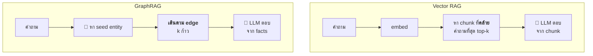
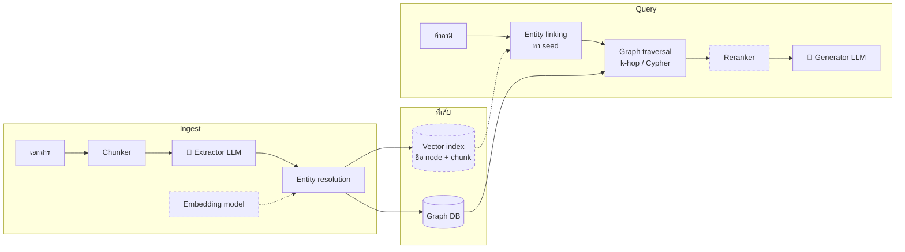

# 3. GraphRAG vs Vector RAG

ทั้งสองแบบเป็น **RAG (Retrieval-Augmented Generation)** คือดึงข้อมูลที่เกี่ยวข้องมาให้ LLM ก่อนตอบ ต่างกันที่ *วิธีดึง*

| | Vector RAG | GraphRAG (repo นี้) |
|---|---|---|
| Ingest | chunk → embed → vector DB | chunk → LLM ดึง triples → กราฟ |
| สิ่งที่เก็บ | ก้อนข้อความ | `(subject) -[RELATION]-> (object)` |
| Retrieve | top-k chunk ที่ *คล้าย* คำถามที่สุด | หา seed entity แล้ว *เดินตาม edge* k ก้าว |
| เก่ง | "เอกสารไหนพูดถึง X" หรือคำถามที่คำตอบอยู่ในก้อนเดียว | คำถาม multi-hop ความสัมพันธ์ และการนับหรือรวมข้อมูล |
| อ่อน | คำตอบที่ต้องต่อจากหลายก้อน | รายละเอียดที่ไม่ได้ดึงออกมาเป็น triple ซึ่งจะหายไป |
| ต้นทุน ingest | ถูก (embedding) | แพง (เรียก LLM ทุก chunk) |



Vector RAG หาข้อมูลจาก **ความคล้ายของข้อความ** ส่วน GraphRAG หาจาก **ความเชื่อมโยงของ entity** ข้อมูลที่ต้องใช้อาจไม่คล้ายคำถามเลย แต่ยังเชื่อมกับ entity ในคำถามได้

## ทำไม Vector RAG ถึงพลาดคำถาม multi-hop

### ตัวอย่างที่ 1: คำถามที่ต้องรวมข้อมูล

> *"ในภาคอีสานมีมรดกโลกอะไรบ้าง และมีประเพณีอะไรบ้าง"*

ในกราฟ ข้อมูลนี้คือทุกอย่างที่เชื่อมกับ node `ภาคอีสาน`:

```
(แหล่งโบราณคดีบ้านเชียง) ─LOCATED_IN─▶ (ภาคอีสาน) ◀─LOCATED_IN─ (จังหวัดเลย) ◀─LOCATED_IN─ (อำเภอด่านซ้าย) ◀─HELD_IN─ (ประเพณีผีตาโขน)
                                          ▲
                        (จังหวัดยโสธร) ─────┘ ◀─HELD_IN─ (ประเพณีบุญบั้งไฟ)
```

**Vector RAG** อาจดึงมาครบเพราะข้อมูลทั้งหมดอยู่ในย่อหน้าเดียว แต่ถ้าข้อมูลกระจายอยู่ใน 50 เอกสาร top-k ก็จะได้มาแค่บางส่วน และไม่มีทางรู้ว่าขาดอะไรไป

**GraphRAG** เดินจาก `ภาคอีสาน` ออกไปได้ครบทุกเส้น ไม่ว่าข้อมูลจะมาจากเอกสารไหน

### ตัวอย่างที่ 2: ข้อมูลที่ไม่คล้ายคำถามเลย

> *"ภาพยนตร์ The Beach ถ่ายทำในจังหวัดใด"*

ย่อหน้าที่พูดถึง The Beach บอกแค่ "อ่าวมาหยาบนเกาะพีพีเล" ส่วนประโยคที่ว่าหมู่เกาะพีพีอยู่จังหวัดกระบี่อยู่คนละประโยค ถ้าข้อมูลสองส่วนนี้อยู่คนละเอกสาร (เช่น เอกสารรีวิวหนัง กับคู่มือท่องเที่ยวกระบี่) เอกสารคู่มือกระบี่จะแทบไม่มีคำที่คล้ายกับ "The Beach" เลย similarity search จึงไม่ดึงเอกสารนั้นมา

**GraphRAG** เดินตาม edge ได้เลย:

```
(The Beach) ─FILMED_AT─▶ (อ่าวมาหยา) ─LOCATED_IN─▶ (เกาะพีพีเล) ─PART_OF─▶ (หมู่เกาะพีพี) ─LOCATED_IN─▶ (จังหวัดกระบี่)
```

ข้อความใน chunk จะคล้ายคำถามหรือไม่ก็ไม่มีผล ขอแค่ entity เชื่อมกันในกราฟก็พอ

ลองเอง:

```bash
uv run main.py ask "ในภาคอีสานมีมรดกโลกอะไรบ้าง และมีประเพณีอะไรบ้าง" --hops 3 -v
uv run main.py ask "ภาพยนตร์ The Beach ถ่ายทำในจังหวัดใด" --hops 4 -v
```

## Service / component ของแต่ละแบบ

GraphRAG แบ่งเป็น service ได้แบบเดียวกับ RAG บางตัวใช้ร่วมกัน บางตัวถูกแทนที่ หรือย้ายไปทำหน้าที่อื่น

| หน้าที่ | Vector RAG | GraphRAG | repo นี้ตอนนี้ |
|---|---|---|---|
| แบ่งข้อมูล | Chunker | Chunker (เหมือนกัน) | `chunk()` ตัดตามย่อหน้า |
| แปลงข้อมูลตอน ingest | Embedding model | **Extractor LLM** ดึง entity + relation | Ollama `extract_triples()` |
| รวม entity ซ้ำ | – | **Entity resolution** (มักใช้ embedding หรือ LLM ช่วย) | `key()` + `aliases` ใน entities.csv |
| กติกาข้อมูล | – | **Ontology / schema** | `ontology.md` |
| ที่เก็บ | Vector DB (Qdrant, pgvector, Pinecone…) | **Graph DB** (Neo4j, Memgraph, FalkorDB, Kuzu, Neptune…) | NetworkX + `graph.json` |
| หาจุดเริ่ม | Embed คำถาม → similarity search | **Entity linking**: หา seed entity (มักใช้ embedding + vector index บนชื่อ node) | ให้ LLM เลือกจากรายชื่อ node ทั้งหมด |
| ดึงข้อมูล | Top-k chunks | **Graph traversal**: k-hop, path, Cypher query | `ego_graph` k-hop |
| จัดอันดับ | Reranker (cross-encoder) | **Reranker** ของ facts หรือ path | ❌ ไม่มี ส่ง facts ทั้งหมด |
| สรุปภาพรวม | – | **Community detection + summarizer** (แบบ Microsoft GraphRAG) | ❌ ไม่มี |
| ตอบ | Generator LLM | Generator LLM (เหมือนกัน) | Ollama ใน `ask()` |
| วัดผล | Eval (RAGAS ฯลฯ) | Eval (เหมือนกัน) | `eval` แบบ LLM-as-judge |

### Embedding กับ vector DB ไม่ได้หายไป

ใน GraphRAG ทั้งสองตัวย้ายไปทำหน้าที่ใหม่ คือ **หา seed entity** และ **รวมชื่อซ้ำ** ระบบจริงส่วนใหญ่จึงเป็นแบบ hybrid ที่มีทั้ง graph DB และ vector index (Neo4j มี vector index ในตัว ไม่ต้องแยก service)



<sub>กรอบเส้นประ = service ที่ repo นี้ยังไม่มี (ตอนนี้ใช้ LLM ทำแทน หรือข้ามไป)</sub>

### repo นี้ใช้ LLM ทำแทนหลายตัว

ทั้งการหา seed และการตอบใช้ LLM ตัวเดียว ซึ่งง่ายแต่ไม่ scale เพราะ `find_seeds()` ส่งรายชื่อ node **ทั้งหมด** ให้ LLM ใช้ได้กับกราฟหลักร้อย node เท่านั้น ถ้าจะทำระบบจริง ควรเพิ่ม service ตามลำดับนี้:

| ลำดับ | เพิ่ม | เมื่อไหร่ |
|---|---|---|
| 1 | **Graph DB** (เช่น Neo4j) | ข้อมูลเกินที่ memory รับได้ หรือหลายคนต้องใช้ร่วมกัน |
| 2 | **Embedding + vector index** สำหรับหา seed | node เกินหลักร้อย หรือคำถามใช้คำที่ไม่ตรงกับชื่อ node |
| 3 | **Reranker** | facts จาก k-hop เยอะจน LLM สับสน หรือเกิน context |
| 4 | **Community summarizer** | ต้องตอบคำถามภาพรวมที่ไม่มี entity ให้เริ่ม |

**Framework ที่รวม service พวกนี้ไว้ให้แล้ว:** Microsoft GraphRAG, LlamaIndex (PropertyGraphIndex), LangChain + Neo4j, neo4j-graphrag-python, LightRAG

## เลือกใช้อะไรดี

- ข้อมูลเป็นเอกสารทั่วไป (รีวิว บทความ) และคำถามส่วนใหญ่เป็น "หาข้อความที่พูดถึง X" → **Vector RAG** ง่ายและถูกกว่า
- ข้อมูลมี entity และความสัมพันธ์ชัดเจน (สถานที่ → จังหวัด → ภาค, ทริป → โรงแรม → สายการบิน, ระบบ dependency) และคำถามเป็นแบบ "เชื่อมโยงกันอย่างไร" หรือ "มีอะไรบ้างใน X" → **GraphRAG**
- ในงานจริงมักใช้ **ทั้งสองแบบร่วมกัน (hybrid)** คือใช้ vector search หา seed entity ใช้กราฟขยายความสัมพันธ์ แล้วแนบ chunk ต้นฉบับ (`source_chunk`) ไปให้ LLM ด้วย ข้อมูลที่ไม่ได้ถูกดึงเป็น triple จะได้ไม่หายไป

ถัดไป: [ข้อจำกัดและสิ่งที่ควรทำต่อ →](04-limitations.md)
