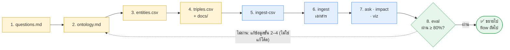

# 6. ลงมือทำ: ตัวอย่างระบบค้าปลีกตั้งแต่ต้นจนจบ

บทนี้ไล่ทีละขั้นว่า **ต้องทำอะไร ใครทำ รันคำสั่งอะไร และควรเห็นผลแบบไหน** โดยใช้ตัวอย่างระบบค้าปลีกที่อยู่ใน [examples/retail-demo/](../examples/retail-demo/) ซึ่ง**รันได้จริงตอนนี้เลย**

> ข้อมูลใน `examples/retail-demo/` เป็น **ข้อมูลสมมติ** ไว้ใช้เป็นต้นแบบ ตอนทำจริงให้แทนด้วยข้อมูลของคุณ

---

## ภาพรวม: ทั้งหมดมี 8 ขั้น



🟨 คนเตรียม · 🟦 รันคำสั่ง · 🟩 ตรวจผล

| ขั้น | ทำอะไร | ใครทำ | ใช้ LLM? |
|---|---|---|---|
| 1–4 | เตรียมไฟล์ข้อมูล | **คน** (ให้ AI ช่วยร่างได้) | – |
| 5 | โหลดตารางเข้ากราฟ | คำสั่ง | ❌ |
| 6 | โหลดเอกสารเข้ากราฟ | คำสั่ง | ✅ |
| 7 | ถามคำถาม / วิเคราะห์ผลกระทบ | คำสั่ง | `ask` ✅ / `impact` ❌ |
| 8 | วัดผล แล้ววนกลับไปแก้ข้อมูล | คำสั่ง + **คน** | ✅ |

**ไม่ต้องแก้โค้ดเลยตลอดทั้ง 8 ขั้น** ทุกอย่างทำผ่านไฟล์ข้อมูลกับคำสั่ง

---

## ขั้นที่ 0 — เตรียมเครื่อง (ครั้งเดียว)

```bash
git clone https://github.com/kitti-noo/knowledge-graph
cd knowledge-graph
uv sync
mkdir -p domains/<ชื่อโดเมน>/docs     # เช่น domains/retail (โฟลเดอร์ domains/ ถูก gitignore ไว้)
```

ต้องติดตั้ง [uv](https://docs.astral.sh/uv/) และ [Ollama](https://ollama.com) ก่อน (Ollama ใช้แค่ขั้นที่ 6–8)

---

## ขั้นที่ 1 — เขียนคำถาม + คำตอบที่ถูก → `questions.md`

**ใคร:** เจ้าของไอเดีย · **ไฟล์ตัวอย่าง:** [examples/retail-demo/questions.md](../examples/retail-demo/questions.md)

```markdown
## Q1: ราคาสินค้าที่ POS ใช้ มาจากระบบไหน และส่งผ่านช่องทางอะไร
คำตอบ: มาจาก RMS ส่งผ่าน Price batch 02:00

## Q2: Coupon Engine ต้องพึ่งระบบอะไร
คำตอบ: CRM (เช็กสิทธิ์สมาชิก)
```

- รูปแบบต้องเป็น `## Qn: คำถาม` ตามด้วยบรรทัด `คำตอบ: ...` เพราะคำสั่ง `eval` อ่านจากรูปแบบนี้
- เขียนด้วยภาษาที่คนในทีมใช้ถามกันจริง

**ทำไมต้องทำก่อน:** คำถามเป็นตัวบอกว่าขั้นที่ 2–4 ต้องเก็บอะไรบ้าง และใช้เป็นข้อสอบในขั้นที่ 8

---

## ขั้นที่ 2 — กำหนดกติกา → `ontology.md`

**ใคร:** เจ้าของไอเดีย · **ไฟล์ตัวอย่าง:** [examples/retail-demo/ontology.md](../examples/retail-demo/ontology.md)

ไล่ดูคำถามทีละข้อ แล้วถามตัวเองว่า "ต้องมี **สิ่ง** อะไร และ **เส้นเชื่อม** แบบไหน ถึงจะตอบข้อนี้ได้"

| คำถาม | ต้องมี |
|---|---|
| ราคามาจากระบบไหน ส่งผ่านช่องทางอะไร | `System`, `DataObject`, `Interface` + `PRODUCES`, `VIA` |
| คูปองใช้ไม่ได้ ติดต่อทีมไหน | `Team` + `OWNED_BY` |
| ถ้า CRM ล่ม กระทบใคร | `DEPENDS_ON`, `SENDS_TO` |

แล้วเขียนเป็นตารางสองตาราง:

```markdown
## Entity types
| Type       | ความหมาย              | ตัวอย่าง         |
|------------|----------------------|-----------------|
| System     | ระบบงาน               | POS, RMS, CRM   |
...

## Relations
| Relation   | จาก → ไป              | ความหมาย              |
|------------|----------------------|----------------------|
| SENDS_TO   | System → System      | ส่งข้อมูลให้            |
| VIA        | DataObject → Interface | ข้อมูลนี้ส่งผ่านช่องทางนี้ |
...
```

**โค้ดใช้ไฟล์นี้ทำ 3 อย่าง:**
1. **ตรวจ CSV** ถ้ามี relation ที่ไม่อยู่ในตาราง หรือทิศทางผิด (เช่น `Price PRODUCES RMS`) จะ error ทันที
2. **ล็อก LLM** ตอนอ่านเอกสาร ให้ใช้ได้เฉพาะ type และ relation ในตาราง
3. **อธิบายความหมาย** คอลัมน์ "ความหมาย" ถูกส่งให้ LLM ตอนตอบคำถาม ([ดูขั้นที่ 8](#รอบที่-2-q1-ไม่ผ่าน--แก้-ontology) ว่าคอลัมน์นี้สำคัญแค่ไหน)

---

## ขั้นที่ 3 — รายชื่อทางการ + ชื่อเล่น → `entities.csv`

**ใคร:** เจ้าของไอเดีย + คนในทีม · **ไฟล์ตัวอย่าง:** [examples/retail-demo/entities.csv](../examples/retail-demo/entities.csv)

```csv
name,type,aliases,owner,description
POS,System,ระบบ POS|เครื่องคิดเงิน|ระบบขายหน้าร้าน,ทีม Store IT,ระบบขายและชำระเงินหน้าร้าน
Coupon Engine,System,ระบบคูปอง|Promo X,ทีม CRM,สร้างและ validate คูปอง
CRM,System,ระบบสมาชิก|ระบบ loyalty,ทีม CRM,ข้อมูลสมาชิกและแต้มสะสม
Price,DataObject,ราคา|ราคาขาย,,ราคาขายปลีกต่อ SKU
```

- **ทุก entity ที่จะใช้ใน triples.csv ต้องมีอยู่ในไฟล์นี้** ไม่ว่าจะเป็นระบบ ข้อมูล ช่องทาง ทีม หรือช่องทางขาย
- `type` ต้องตรงกับ ontology.md
- `aliases` คือชื่ออื่นที่คนเรียก คั่นด้วย `|` ระบบจะแปลงเป็นชื่อทางการให้อัตโนมัติ ทั้งใน CSV, ในเอกสาร และในคำถาม
- **นี่คือขั้นที่คนต้องตัดสินใจเอง** เช่น "Promo X" เป็นชื่อเก่าของ Coupon Engine หรือเป็นอีกระบบหนึ่ง ข้อนี้มีแค่คนในทีมที่รู้

---

## ขั้นที่ 4 — ความสัมพันธ์ → `triples.csv` (+ เอกสารใน `docs/`)

**ใคร:** คนในทีม (หรือให้ AI แปลงจาก integration list แล้วคนตรวจ) · **ไฟล์ตัวอย่าง:** [examples/retail-demo/triples.csv](../examples/retail-demo/triples.csv)

```csv
subject,relation,object,note,source
RMS,PRODUCES,Price,,interface-list.xlsx
RMS,SENDS_TO,POS,ราคา product master และโปรโมชัน,interface-list.xlsx
Price,VIA,Price batch 02:00,ทุกคืน 02:00,คุยกับทีม Merch IT
Coupon Engine,DEPENDS_ON,CRM,เช็กสิทธิ์สมาชิกก่อน validate,INC-1234
ระบบคูปอง,OWNED_BY,ทีม CRM,,                ← ใช้ชื่อเล่นได้ ระบบแปลงให้
```

- **หนึ่งแถว = หนึ่งความสัมพันธ์** `subject` คือต้นทาง `object` คือปลายทาง
- `note` ใช้ใส่รายละเอียด (เวลา ความถี่ เงื่อนไข) ซึ่งจะแสดงเมื่อเอาเมาส์ชี้เส้นใน viz และถูกส่งให้ LLM ตอนตอบคำถามด้วย
- `source` ระบุว่าข้อมูลมาจากไหน ใช้ย้อนกลับไปตรวจได้

**เอกสาร (ถ้ามี):** วางไฟล์ `.md` ไว้ใน `docs/` เช่น [examples/retail-demo/docs/line-coupon.md](../examples/retail-demo/docs/line-coupon.md) ใช้เติมข้อมูลที่ยังไม่มีในตาราง

---

## ขั้นที่ 5 — โหลดตารางเข้ากราฟ

```bash
uv run main.py ingest-csv --domain examples/retail-demo --reset
```

**ผลที่ควรเห็น:**

```
triples.csv: 41 triples
graph: 29 nodes, 41 edges -> examples/retail-demo/graph.json
```

**ถ้าข้อมูลผิด ระบบจะบอกทุกแถวที่ต้องแก้ในครั้งเดียว** ตัวอย่างนี้ทดสอบด้วยการใส่ข้อมูลผิดลงไปตั้งใจ:

```
fix these rows, then run again:
triples.csv row 3: PRODUCES must go System -> DataObject, got Price (DataObject) -> RMS (System); reversed?
triples.csv row 5: relation 'TALKS_TO' is not in ontology.md
triples.csv row 6: subject 'Loyalty Hub' is not in entities.csv
```

| error | แก้ที่ไหน |
|---|---|
| `reversed?` | สลับ subject กับ object ใน triples.csv |
| `not in ontology.md` | ใช้ relation ที่มีอยู่แล้ว หรือเพิ่ม relation ใหม่ใน ontology.md |
| `not in entities.csv` | สะกดผิด → แก้ให้ตรง / เป็นของใหม่ → เพิ่มใน entities.csv / เป็นชื่อเล่น → เพิ่มใน aliases |

ขั้นนี้ไม่ใช้ LLM จึงเร็ว ฟรี และให้ผลเหมือนเดิมทุกครั้ง

---

## ขั้นที่ 6 — โหลดเอกสารเข้ากราฟ (ถ้ามี)

```bash
uv run main.py ingest --domain examples/retail-demo examples/retail-demo/docs/*.md
```

> ⚠️ รันขั้นนี้ **หลัง** ขั้นที่ 5 ทุกครั้ง เพราะ `ingest-csv --reset` จะล้างกราฟแล้วสร้างใหม่จากตาราง

เอกสารตัวอย่างเขียนโดยใช้ **ชื่อเล่น** และมี **ระบบที่ไม่อยู่ใน entities.csv**:

> ระบบคูปองต้องพึ่งระบบสมาชิกเพื่อเช็กว่าผู้ใช้ LINE เป็นสมาชิกหรือไม่ ... Chatbot ส่งข้อมูลการกดรับคูปองให้ระบบคูปอง

**ผลที่ได้:**

```
  dropped (Coupon) -[VIA]-> (LINE OA): wrong direction/types for VIA
  new entities (add to entities.csv if they are real): Chatbot (System)
examples/retail-demo/docs/line-coupon.md: 6 triples
```

ระบบทำ 3 อย่างให้:
1. **แปลงชื่อเล่น** "ระบบคูปอง" → `Coupon Engine` และ "ระบบสมาชิก" → `CRM` ทำให้ข้อมูลจากเอกสารต่อเข้ากับ node เดิมได้ ไม่เกิด node ซ้ำ
2. **ทิ้ง triple ที่ผิดกติกา** LINE OA เป็น `Channel` ไม่ใช่ `Interface` จึงใช้ `VIA` ไม่ได้
3. **รายงาน entity ใหม่** `Chatbot` ไม่มีใน entities.csv ระบบยังเก็บไว้ในกราฟ แต่แจ้งให้**คน**ตัดสินว่าจะเพิ่มเข้า entities.csv หรือไม่ ถ้าเป็นระบบจริง ให้เพิ่มเข้าไป รอบหน้าจะได้มี type และ aliases ที่ถูกต้อง

---

## ขั้นที่ 7 — ใช้งาน

### `impact` — ถ้าระบบนี้ล่ม ใครกระทบ (ไม่ใช้ LLM)

```bash
uv run main.py impact --domain examples/retail-demo "ระบบสมาชิก"
```

```
if CRM goes down, 7 may be affected:
  Coupon Engine  direct   (CRM) <-[DEPENDS_ON]- (Coupon Engine)
  Mobile App     direct   (CRM) <-[DEPENDS_ON]- (Mobile App)
  POS            chain 2  (CRM) <-[DEPENDS_ON]- (Coupon Engine) <-[DEPENDS_ON]- (POS)
  E-commerce     chain 2  (CRM) <-[DEPENDS_ON]- (Coupon Engine) <-[DEPENDS_ON]- (E-commerce)
  Chatbot        chain 2  (CRM) <-[DEPENDS_ON]- (Coupon Engine) <-[DEPENDS_ON]- (Chatbot)
  ERP            chain 3  (CRM) <-[DEPENDS_ON]- (Coupon Engine) <-[DEPENDS_ON]- (POS) -[SENDS_TO]-> (ERP)
  WMS            chain 3  (CRM) <-[DEPENDS_ON]- (Coupon Engine) <-[DEPENDS_ON]- (E-commerce) -[SENDS_TO]-> (WMS)
```

- `Chatbot` มาจากเอกสารที่ ingest ในขั้นที่ 6 ข้อมูลจากตารางและเอกสารรวมกันอยู่ในกราฟเดียว
- `direct` คือได้รับผลกระทบโดยตรง ส่วน `chain N` คือกระทบต่อเป็นทอดที่ N
- ผลนี้เป็น **กรณีแย่ที่สุด** เช่น ใน note บอกว่า POS "ชำระด้วยคูปองไม่ได้ แต่ขายปกติได้" ดังนั้น ERP อาจไม่ได้รับผลกระทบจริง ให้คนเป็นคนตัดสินขั้นสุดท้าย
- กฎที่ใช้: X ล่มแล้ว Y กระทบ เมื่อ `Y DEPENDS_ON X` หรือ `X SENDS_TO Y` หรือ `X PRODUCES ข้อมูล` ที่ `Y CONSUMES`

### `ask` — คำถามภาษาคน (ใช้ LLM)

```bash
uv run main.py ask --domain examples/retail-demo "ถ้าคูปองใช้ไม่ได้ ต้องติดต่อทีมไหน" -v
```

ใส่ `-v` เพื่อดูว่าระบบใช้ facts อะไรในการตอบ

### `viz` — ดูภาพกราฟ

```bash
uv run main.py viz --domain examples/retail-demo     # → examples/retail-demo/graph.html
```

ลากดูได้ และเอาเมาส์ชี้ที่เส้นจะเห็น note และ source **เปิดให้ domain expert ดูเป็นวิธีตรวจที่ได้ผลที่สุด**

---

## ขั้นที่ 8 — วัดผล แล้ววนกลับไปแก้

```bash
uv run main.py eval --domain examples/retail-demo
```

คำสั่งนี้ถามทุกข้อใน questions.md แล้วให้ LLM เทียบคำตอบกับคำตอบที่ถูก ต่อไปนี้คือผลจริงตอนทำตัวอย่างนี้:

### รอบที่ 1: 6/7 — Q5 ไม่ผ่าน → แก้ข้อมูล

```
FAIL  Q5: เว็บขายของใช้ข้อมูลอะไรบ้าง
      expected: Price และ Stock (และใช้คูปองผ่าน Coupon Engine)
      missing:  คูปอง (Coupon Engine)
      seeds:    ['e-commerce']
```

- **สาเหตุ:** triples.csv มี `E-commerce DEPENDS_ON Coupon Engine` แต่ไม่มี `E-commerce CONSUMES Coupon` คำถาม "ใช้ข้อมูลอะไร" จึงไม่เจอคูปอง
- **แก้:** เพิ่มแถว `E-commerce,CONSUMES,Coupon,ใช้คูปองตอน checkout,คุยกับทีม Digital` ใน triples.csv แล้วรันขั้นที่ 5 → 6 → 8 ใหม่

### รอบที่ 2: Q1 ไม่ผ่าน → แก้ ontology

```
FAIL  Q1: ราคาสินค้าที่ POS ใช้ มาจากระบบไหน และส่งผ่านช่องทางอะไร
      missing:  Price batch 02:00
```

- **สาเหตุ:** ดูด้วย `ask -v` แล้วพบว่ามี fact `(Price) -[VIA]-> (Price batch 02:00)` อยู่แล้ว แต่ LLM ไม่รู้ว่า `VIA` แปลว่า "ช่องทาง" เลยไปตอบด้วย `SENDS_TO` แทน
- **แก้:** ส่งคอลัมน์ "ความหมาย" ใน ontology.md ให้ LLM ตอนตอบด้วย (ตอนนี้ระบบทำให้อัตโนมัติแล้ว) ดังนั้น **ให้เขียนความหมายของแต่ละ relation ด้วยคำที่คนในทีมใช้ถามจริง**

### รอบที่ 3: 7/7 ✅

```
PASS  Q1: ราคาสินค้าที่ POS ใช้ มาจากระบบไหน และส่งผ่านช่องทางอะไร
PASS  Q2: Coupon Engine ต้องพึ่งระบบอะไร
...
7/7 passed
```

### ตอบผิดแล้วแก้ที่ไหน

| อาการตอน `eval` / `ask -v` | สาเหตุ | แก้ที่ |
|---|---|---|
| facts ไม่มีข้อมูลที่ต้องใช้ | ข้อมูลยังไม่ครบ | เพิ่มแถวใน `triples.csv` |
| `seeds` ว่าง หรือผิดตัว | คำถามใช้ชื่อที่ระบบไม่รู้จัก | เพิ่ม `aliases` ใน `entities.csv` |
| มี facts ครบ แต่ LLM ตีความผิด | ความหมายของ relation ไม่ชัด | แก้คอลัมน์ "ความหมาย" ใน `ontology.md` |
| คำตอบต้องเดินไกลกว่า 2 ก้าว | `--hops` น้อยไป | `eval --hops 3` |
| ผลไม่เหมือนเดิมทุกรอบ | LLM ไม่ deterministic | รัน eval 2–3 รอบ แล้วดูข้อที่ไม่ผ่านซ้ำๆ |

> สังเกตว่าทั้งสามรอบ **ไม่ได้แก้โค้ดเลย** (ยกเว้นการส่ง "ความหมาย" ให้ LLM ซึ่งตอนนี้ระบบทำให้อัตโนมัติแล้ว) งานหลักของ KG จึงอยู่ที่การดูแลข้อมูล

---

## สรุปคำสั่งทั้งหมด

```bash
D=examples/retail-demo                                       # เปลี่ยนเป็นโดเมนของคุณ

uv run main.py ingest-csv --domain $D --reset       # 5. ตาราง → กราฟ (ทุกครั้งที่แก้ CSV)
uv run main.py ingest     --domain $D $D/docs/*.md  # 6. เอกสาร → กราฟ (ถ้ามี)
uv run main.py stats      --domain $D               # node ไหนเชื่อมเยอะ / ไม่เชื่อมกับอะไร
uv run main.py viz        --domain $D               # เปิด $D/graph.html
uv run main.py impact     --domain $D "ชื่อระบบ"      # 7. ถ้าล่ม กระทบใคร
uv run main.py ask        --domain $D "คำถาม" -v     # 7. ถามภาษาคน
uv run main.py eval       --domain $D               # 8. วัดผลกับ questions.md
```

## เริ่มโดเมนของคุณเอง

1. `cp -r examples/retail-demo domains/<โดเมนของคุณ>` แล้วลบ `graph.json` / `graph.html` ทิ้ง
2. แก้ทั้ง 4 ไฟล์ตามลำดับขั้นที่ 1 → 4 (ใช้ไฟล์ตัวอย่างเป็นต้นแบบ)
3. รันขั้นที่ 5 → 8 แล้ววนรอบจนผ่านราว 80%
4. ถ้าต้องการความสามารถที่ยังไม่มี (เช่น ดึงข้อมูลจาก API โดยตรง หรือ export ไป Neo4j) ค่อยให้ AI เขียนเพิ่ม (ดู[บทที่ 5 ข้อ 4.2](05-start-your-own.md#42-คำสั่งที่มีให้แล้ว-และเมื่อไหร่ต้องให้-ai-เขียนเพิ่ม))

กลับไป: [สารบัญ](README.md)
